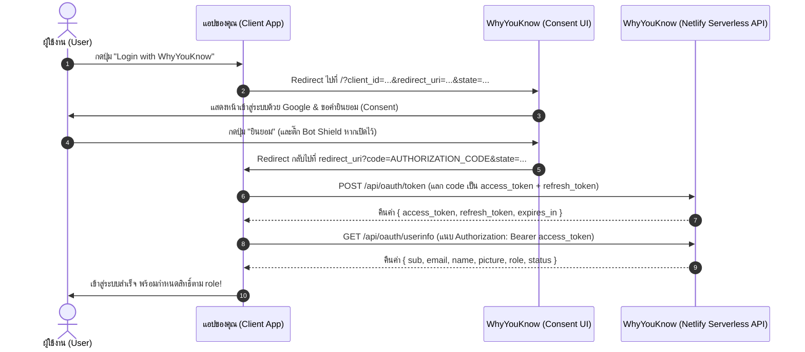

# 📘 How to Use WhyYouKnow — Developer Integration Guide (OAuth 2.0 & SSO)

คู่มือฉบับสมบูรณ์สำหรับนักพัฒนาในการนำแอปพลิเคชันภายนอก (Web App, SPA, Backend API) มาเชื่อมต่อระบบยืนยันตัวตนแบบรวมศูนย์ (**Single Sign-On / OAuth 2.0 Provider**) กับ **WhyYouKnow** (รันบน Netlify Serverless + Supabase PostgreSQL)

---

## 🌐 1. ข้อมูลเซิร์ฟเวอร์ (Environment URLs)

บน Netlify ทั้งหน้าเว็บ Frontend และ Serverless API จะทำงานอยู่ภายใต้ **Domain เดียวกัน** อย่างเป็นเอกภาพ:

| รายการ | Production (Netlify) | Local Development |
| :--- | :--- | :--- |
| **Frontend / Consent URL** *(สำหรับส่งผู้ใช้ไปหน้า Login)* | `https://<YOUR-APP>.netlify.app` | `http://localhost:5173` |
| **Backend API Base URL** *(สำหรับแลกเปลี่ยน Token / ดึงข้อมูลผู้ใช้)* | `https://<YOUR-APP>.netlify.app/api` | `http://localhost:5173/api` *(หรือ `http://localhost:8888/api`)* |

---

## 🔄 2. แผนผังการทำงาน (OAuth 2.0 Flow)



---

## ⚙️ 3. ขั้นตอนที่ 1: ลงทะเบียนแอปพลิเคชันของคุณในหน้า Admin

ก่อนเริ่มเขียนโค้ด ให้เข้าไปสร้าง OAuth Client ในระบบ WhyYouKnow:

1. เข้าสู่เว็บ **WhyYouKnow** ด้วยบัญชีแอดมิน
2. ไปที่เมนู **จัดการระบบ (Admin)** > แท็บ **OAuth Apps**
3. กรอกข้อมูลในฟอร์ม **ลงทะเบียนแอปพลิเคชันใหม่**:
   - **ชื่อแอปพลิเคชัน (App Name):** เช่น `Mini PM` หรือ `My CRM`
   - **Redirect URIs:** ระบุ Callback URL ของแอปคุณ (คั่นด้วยจุลภาคหากมีหลายค่า) เช่น:
     - `http://localhost:3000/auth/callback, https://myapp.example.com/auth/callback`
   - **ประเภทของแอป (Client Type):**
     - 🔒 **Confidential Client** *(ติ๊กถูก)* — สำหรับแอปที่มี **Backend Server** (Node.js, Python, Go, PHP) ซึ่งสามารถเก็บรักษา `client_secret` ไว้เป็นความลับบนเซิร์ฟเวอร์ได้
     - 🌐 **Public Client (SPA / Mobile)** *(ไม่ติ๊ก)* — สำหรับเว็บ Frontend ล้วน (React, Vue, Vite) ที่ไม่มี Backend ของตัวเอง ระบบจะบังคับใช้มาตรฐาน **PKCE (`S256`)** แทนการใช้ `client_secret`
4. กด **สร้าง Client** แล้วคัดลอก **`client_id`** และ **`client_secret`** (สำหรับ Confidential Client จะแสดงเพียงครั้งเดียว) เก็บไว้ในไฟล์ `.env` ของโปรเจกต์คุณ

> [!TIP]
> คุณสามารถตั้งค่าความปลอดภัยเพิ่มเติมต่อแอปได้ในตาราง OAuth Apps:
> - **Access Mode:** เลือก `Open` (เปิดให้ทุกคนเข้าใช้) หรือ `Invite Only` (เฉพาะอีเมลที่แอดมินเชิญไว้ล่วงหน้า)
> - **🛡️ Attack Protection:** เปิด/ปิด `Bot Detection`, `Suspicious IP Throttling`, `Brute-force Protection`, และ `Suspicious Account Shield` แยกรายแอปได้ทันที

---

## 📡 4. ขั้นตอนที่ 2: รายละเอียด API Endpoints (API Specification)

### 4.1 ส่งผู้ใช้ไปหน้าขออนุญาต (Authorization Redirect)
ให้แอปของคุณส่ง (Redirect) เบราว์เซอร์ของผู้ใช้ไปยัง URL หน้าเว็บของ WhyYouKnow พร้อม Query Parameters:

```text
GET https://<YOUR-APP>.netlify.app/?client_id={CLIENT_ID}&redirect_uri={REDIRECT_URI}&state={RANDOM_STATE}&code_challenge={PKCE_CHALLENGE}&code_challenge_method=S256
```

| Parameter | จำเป็น | คำอธิบาย |
| :--- | :---: | :--- |
| `client_id` | ✅ | รหัส Client ID ของแอปคุณ (เช่น `wyk_...`) |
| `redirect_uri` | ✅ | Callback URL ที่ลงทะเบียนไว้ในระบบ ต้องตรงกันทุกตัวอักษร |
| `state` | แนะนำ | ค่าสุ่มสำหรับป้องกัน CSRF (ระบบจะส่งค่านี้กลับไปให้ที่ `redirect_uri` เหมือนเดิม) |
| `code_challenge` | บังคับสำหรับ Public Client | ค่า SHA-256 Hash (Base64URL-encoded) ของ `code_verifier` ตามมาตรฐาน PKCE |
| `code_challenge_method` | บังคับสำหรับ Public Client | กำหนดเป็น `S256` |

เมื่อผู้ใช้กด **"ยินยอม"** ระบบจะ Redirect กลับมายัง `redirect_uri` ของคุณ:
```text
https://your-app.com/auth/callback?code=wyk_code_xxxxxx&state=xyz123
```
*(หากผู้ใช้กด "ปฏิเสธ" จะ Redirect กลับมาพร้อม `?error=access_denied`)*

---

### 4.2 แลกเปลี่ยน Authorization Code เป็น Token (`POST /api/oauth/token`)

> [!IMPORTANT]
> Endpoint `/api/oauth/token` และ `/api/oauth/revoke` ของ WhyYouKnow รับข้อมูลในรูปแบบ **JSON (`Content-Type: application/json`)**

**Request:**
```http
POST /api/oauth/token HTTP/1.1
Host: <YOUR-APP>.netlify.app
Content-Type: application/json

{
  "grant_type": "authorization_code",
  "client_id": "wyk_your_client_id",
  "client_secret": "wyk_sec_your_client_secret",
  "code": "AUTHORIZATION_CODE_FROM_CALLBACK",
  "redirect_uri": "http://localhost:3000/auth/callback",
  "code_verifier": "PKCE_CODE_VERIFIER_IF_USED"
}
```
*(หมายเหตุ: Authorization Code มีอายุ 10 นาที และใช้งานได้เพียงครั้งเดียว ห้ามนำกลับมาใช้ซ้ำ)*

**Response (`200 OK`):**
```json
{
  "access_token": "wyk_at_...",
  "token_type": "Bearer",
  "expires_in": 3600,
  "refresh_token": "wyk_rt_..."
}
```

---

### 4.3 ดึงข้อมูลโปรไฟล์และ Role ของผู้ใช้ (`GET /api/oauth/userinfo`)

นำ `access_token` ที่ได้ใส่ใน Header `Authorization: Bearer <token>` เพื่อดึงข้อมูลผู้ใช้และสิทธิ์ (`role`) ประจำแอปของคุณ:

**Request:**
```http
GET /api/oauth/userinfo HTTP/1.1
Host: <YOUR-APP>.netlify.app
Authorization: Bearer wyk_at_...
```

**Response (`200 OK`):**
```json
{
  "sub": "109876543210123456789",
  "email": "user@example.com",
  "name": "สมชาย ใจดี",
  "picture": "https://lh3.googleusercontent.com/...",
  "role": "admin",
  "status": "active"
}
```
- **`role`**: ค่าที่เป็นไปได้คือ `"admin"`, `"member"`, หรือ `"viewer"` ซึ่งแอดมินตั้งค่าให้ผู้ใช้คนนี้เฉพาะในแอปของคุณ!
- **`status`**: สถานะการเข้าถึงแอป (`"active"`)

---

### 4.4 ต่ออายุ Access Token ด้วย Refresh Token (`POST /api/oauth/token`)

เมื่อ `access_token` หมดอายุ (ค่าเริ่มต้น 60 นาที) ให้ส่ง `refresh_token` มาขอ Token ชุดใหม่:

**Request:**
```json
{
  "grant_type": "refresh_token",
  "client_id": "wyk_your_client_id",
  "client_secret": "wyk_sec_your_client_secret",
  "refresh_token": "wyk_rt_current_refresh_token"
}
```

**Response (`200 OK`):**
```json
{
  "access_token": "wyk_at_NEW_ACCESS_TOKEN",
  "token_type": "Bearer",
  "expires_in": 3600,
  "refresh_token": "wyk_rt_NEW_REFRESH_TOKEN"
}
```

> [!WARNING]
> **Refresh Token Rotation & Reuse Detection:**
> ทุกครั้งที่ใช้ `refresh_token` ระบบจะออก `refresh_token` ตัวใหม่ให้เสมอ และตัวเก่าจะถูกยกเลิกทันที แอปของคุณ**ต้องบันทึก `refresh_token` ตัวใหม่ทับตัวเก่าทุกครั้ง** หากมีการนำตัวเก่ามาเรียกซ้ำ ระบบจะถือว่า Token ถูกขโมยและจะเพิกถอน Token ทั้งหมดของผู้ใช้คนนั้นทันที!

---

### 4.5 เพิกถอน Token เมื่อออกจากระบบ (`POST /api/oauth/revoke`)

เมื่อผู้ใช้กด Logout ออกจากแอปของคุณ ควรเรียก Endpoint นี้เพื่อทำลาย Token ทันที:

**Request:**
```json
{
  "client_id": "wyk_your_client_id",
  "client_secret": "wyk_sec_your_client_secret",
  "token": "wyk_rt_...",
  "token_type_hint": "refresh_token"
}
```

**Response (`200 OK`):**
```json
{
  "ok": true
}
```

---

## 💻 5. ขั้นตอนที่ 3: ตัวอย่างโค้ดการใช้งานจริง (Code Examples)

### รูปแบบที่ 1: Public Client — React / TypeScript SPA (ใช้ PKCE S256)

เหมาะสำหรับเว็บ Frontend SPA ที่ทำงานบนเบราว์เซอร์โดยไม่ต้องมี Backend เก็บ Secret

#### ไฟล์ `src/auth/whyyouknow.ts`
```typescript
const WYK_BASE_URL = 'https://<YOUR-APP>.netlify.app';
const CLIENT_ID = 'wyk_your_public_client_id';
const REDIRECT_URI = `${window.location.origin}/auth/callback`;

// 1. ฟังก์ชันสร้าง PKCE Code Verifier และ Code Challenge (S256)
function base64UrlEncode(buffer: ArrayBuffer): string {
  const bytes = new Uint8Array(buffer);
  let binary = '';
  for (let i = 0; i < bytes.byteLength; i++) {
    binary += String.fromCharCode(bytes[i]);
  }
  return btoa(binary).replace(/\+/g, '-').replace(/\//g, '_').replace(/=+$/, '');
}

export async function createPkcePair() {
  const array = new Uint8Array(32);
  window.crypto.getRandomValues(array);
  const codeVerifier = base64UrlEncode(array.buffer);

  const encoder = new TextEncoder();
  const data = encoder.encode(codeVerifier);
  const digest = await window.crypto.subtle.digest('SHA-256', data);
  const codeChallenge = base64UrlEncode(digest);

  return { codeVerifier, codeChallenge };
}

// 2. ฟังก์ชันเริ่มต้น Login (เรียกเมื่อผู้ใช้กดปุ่ม Login)
export async function loginWithWhyYouKnow() {
  const { codeVerifier, codeChallenge } = await createPkcePair();
  const state = window.crypto.randomUUID();

  // บันทึกไว้ใน sessionStorage เพื่อใช้ตรวจสอบตอน Callback
  sessionStorage.setItem('wyk_code_verifier', codeVerifier);
  sessionStorage.setItem('wyk_oauth_state', state);

  const params = new URLSearchParams({
    client_id: CLIENT_ID,
    redirect_uri: REDIRECT_URI,
    state,
    code_challenge: codeChallenge,
    code_challenge_method: 'S256',
  });

  window.location.href = `${WYK_BASE_URL}/?${params.toString()}`;
}

// 3. ฟังก์ชันจัดการหน้า Callback (/auth/callback)
export async function handleOAuthCallback() {
  const params = new URLSearchParams(window.location.search);
  const code = params.get('code');
  const state = params.get('state');
  const error = params.get('error');

  if (error) {
    throw new Error(`การเข้าสู่ระบบถูกปฏิเสธ: ${error}`);
  }

  const savedState = sessionStorage.getItem('wyk_oauth_state');
  const codeVerifier = sessionStorage.getItem('wyk_code_verifier');

  if (!code || state !== savedState || !codeVerifier) {
    throw new Error('ข้อมูล OAuth State หรือ Code Verifier ไม่ถูกต้อง');
  }

  // ล้างค่าชั่วคราว
  sessionStorage.removeItem('wyk_oauth_state');
  sessionStorage.removeItem('wyk_code_verifier');

  // แลกเปลี่ยน Code เป็น Token
  const tokenRes = await fetch(`${WYK_BASE_URL}/api/oauth/token`, {
    method: 'POST',
    headers: { 'Content-Type': 'application/json' },
    body: JSON.stringify({
      grant_type: 'authorization_code',
      client_id: CLIENT_ID,
      code,
      redirect_uri: REDIRECT_URI,
      code_verifier: codeVerifier,
    }),
  });

  if (!tokenRes.ok) {
    const err = await tokenRes.json().catch(() => ({}));
    throw new Error(err.detail || 'แลกเปลี่ยน Token ไม่สำเร็จ');
  }

  const tokens = await tokenRes.json();
  localStorage.setItem('access_token', tokens.access_token);
  localStorage.setItem('refresh_token', tokens.refresh_token);

  // ดึงข้อมูลโปรไฟล์และ Role
  return await fetchUserProfile(tokens.access_token);
}

// 4. ฟังก์ชันดึงข้อมูลผู้ใช้และ Role
export async function fetchUserProfile(accessToken: string) {
  const res = await fetch(`${WYK_BASE_URL}/api/oauth/userinfo`, {
    headers: { Authorization: `Bearer ${accessToken}` },
  });
  if (!res.ok) throw new Error('ไม่สามารถดึงข้อมูลผู้ใช้ได้');
  return await res.json() as {
    sub: string;
    email: string;
    name: string;
    picture: string;
    role: 'admin' | 'member' | 'viewer';
    status: string;
  };
}
```

---

### รูปแบบที่ 2: Confidential Client — Node.js / Express Backend

เหมาะสำหรับเว็บที่มีเซิร์ฟเวอร์ Backend เก็บ `CLIENT_SECRET` ได้อย่างปลอดภัย

```javascript
import express from 'express';
import crypto from 'crypto';

const app = express();
app.use(express.json());

const WYK_BASE_URL = process.env.WYK_BASE_URL || 'https://<YOUR-APP>.netlify.app';
const CLIENT_ID = process.env.WYK_CLIENT_ID;
const CLIENT_SECRET = process.env.WYK_CLIENT_SECRET;
const REDIRECT_URI = 'http://localhost:3000/auth/callback';

// 1. ส่งผู้ใช้ไปล็อกอินที่ WhyYouKnow
app.get('/auth/login', (req, res) => {
  const state = crypto.randomBytes(16).toString('hex');
  // ใน Production ควรเก็บ state ไว้ใน HttpOnly Cookie หรือ Session
  const params = new URLSearchParams({
    client_id: CLIENT_ID,
    redirect_uri: REDIRECT_URI,
    state,
  });
  res.redirect(`${WYK_BASE_URL}/?${params.toString()}`);
});

// 2. รับ Authorization Code จาก Callback และแลกเป็น Token
app.get('/auth/callback', async (req, res) => {
  const { code, error } = req.query;
  if (error || !code) {
    return res.status(400).send(`Login Failed: ${error || 'Missing code'}`);
  }

  try {
    // 2.1 แลก Code เป็น Access Token + Refresh Token
    const tokenResponse = await fetch(`${WYK_BASE_URL}/api/oauth/token`, {
      method: 'POST',
      headers: { 'Content-Type': 'application/json' },
      body: JSON.stringify({
        grant_type: 'authorization_code',
        client_id: CLIENT_ID,
        client_secret: CLIENT_SECRET,
        code: String(code),
        redirect_uri: REDIRECT_URI,
      }),
    });

    if (!tokenResponse.ok) {
      const errData = await tokenResponse.json();
      return res.status(401).json(errData);
    }

    const tokens = await tokenResponse.json();

    // 2.2 ดึงข้อมูลผู้ใช้และ Role ประจำแอป
    const userResponse = await fetch(`${WYK_BASE_URL}/api/oauth/userinfo`, {
      headers: { Authorization: `Bearer ${tokens.access_token}` },
    });
    const user = await userResponse.json();

    // user จะมี { sub, email, name, picture, role, status }
    // นำไปสร้าง Session ของเว็บคุณและควบคุมสิทธิ์ตาม user.role ได้ทันที
    res.json({
      message: 'เข้าสู่ระบบสำเร็จ!',
      user,
      tokens,
    });
  } catch (err) {
    res.status(500).json({ error: err.message });
  }
});

app.listen(3000, () => console.log('Client app listening on http://localhost:3000'));
```

---

### รูปแบบที่ 3: Confidential Client — Python / FastAPI Backend

สำหรับโปรเจกต์ที่ใช้ Python / FastAPI เป็น Backend และต้องการตรวจสอบสิทธิ์ตาม Role (`admin`, `member`, `viewer`):

```python
import os
import httpx
from fastapi import FastAPI, HTTPException, Header, Depends
from fastapi.responses import RedirectResponse

app = FastAPI()

WYK_BASE_URL = os.getenv("WYK_BASE_URL", "https://<YOUR-APP>.netlify.app")
CLIENT_ID = os.getenv("WYK_CLIENT_ID", "wyk_your_client_id")
CLIENT_SECRET = os.getenv("WYK_CLIENT_SECRET", "wyk_sec_your_secret")
REDIRECT_URI = "http://localhost:3000/auth/callback"


@app.get("/auth/login")
def login():
    url = f"{WYK_BASE_URL}/?client_id={CLIENT_ID}&redirect_uri={REDIRECT_URI}"
    return RedirectResponse(url)


@app.get("/auth/callback")
async def callback(code: str):
    async with httpx.AsyncClient() as client:
        # 1. แลกเปลี่ยน Code เป็น Token
        token_res = await client.post(
            f"{WYK_BASE_URL}/api/oauth/token",
            json={
                "grant_type": "authorization_code",
                "client_id": CLIENT_ID,
                "client_secret": CLIENT_SECRET,
                "code": code,
                "redirect_uri": REDIRECT_URI,
            },
        )
        if token_res.status_code != 200:
            raise HTTPException(token_res.status_code, token_res.json())

        tokens = token_res.json()

        # 2. ดึงข้อมูล UserInfo + Role
        user_res = await client.get(
            f"{WYK_BASE_URL}/api/oauth/userinfo",
            headers={"Authorization": f"Bearer {tokens['access_token']}"},
        )
        user = user_res.json()

    return {"user": user, "tokens": tokens}


# ตัวอย่าง Middleware ตรวจสอบสิทธิ์จาก Token ของ WhyYouKnow
async def get_current_wyk_user(authorization: str = Header(...)):
    async with httpx.AsyncClient() as client:
        res = await client.get(
            f"{WYK_BASE_URL}/api/oauth/userinfo",
            headers={"Authorization": authorization},
        )
        if res.status_code != 200:
            raise HTTPException(res.status_code, "Invalid or expired WhyYouKnow token")
        return res.json()


@app.delete("/projects/{project_id}")
async def delete_project(project_id: int, user: dict = Depends(get_current_wyk_user)):
    # ตรวจสอบ Role ที่กำหนดมาจากหน้า Admin ของ WhyYouKnow
    if user["role"] != "admin":
        raise HTTPException(403, "เฉพาะ Admin ของแอปนี้เท่านั้นที่สามารถลบโปรเจกต์ได้")
    return {"deleted": project_id, "by": user["email"]}
```

---

## 🛡️ 6. รหัสข้อผิดพลาดและการรับมือ (Error Handling Reference)

เมื่อแอปของคุณเรียกใช้งาน API ของ WhyYouKnow อาจได้รับ HTTP Status Codes ดังต่อไปนี้เมื่อระบบความปลอดภัยทำงาน:

| Status Code | ข้อความ (`detail`) | สาเหตุและวิธีแก้ไข |
| :---: | :--- | :--- |
| `400` | `bot_detection: verification challenge required` | แอปเปิด **Bot Detection** ไว้ ผู้ใช้ต้องติ๊กกล่องยืนยันความเป็นมนุษย์ในหน้า Consent ก่อนกดยินยอม |
| `400` | `invalid_grant: code already used` | นำ Authorization Code เดิมมาแลกซ้ำ (ระบบได้เพิกถอน Token ทั้งหมดเพื่อความปลอดภัยแล้ว) |
| `400` | `invalid_grant: refresh token reuse detected` | มีการนำ Refresh Token ตัวเก่าที่ถูกหมุนเวียนไปแล้วมาใช้ซ้ำ ให้ส่งผู้ใช้ไปหน้า Login ใหม่ |
| `401` | `invalid_token: token expired or not found` | Access Token หมดอายุหรือถูกยกเลิก ให้ใช้ `refresh_token` ขอใหม่ หรือให้ผู้ใช้ล็อกอินใหม่ |
| `403` | `invite_only: your email is not invited to this application` | แอปตั้งค่าเป็นโหมด **Invite Only** ต้องให้แอดมินเพิ่มอีเมลผู้ใช้ในหน้าจัดการแอปก่อน |
| `403` | `access_denied: user access is revoked for this app` | แอดมินได้กด **"ตัดสิทธิ์ (Revoke)"** ผู้ใช้คนนี้ออกจากแอปของคุณ |
| `403` | `access_denied: user account is suspended` | บัญชีผู้ใช้นี้ถูกระงับการใช้งานชั่วคราว (Global Suspend) |
| `403` | `client_disabled: this client application has been disabled` | แอปพลิเคชันของคุณถูกปิดสวิตช์การใช้งานชั่วคราวในหน้า Admin |
| `429` | `brute_force_protection: too many failed attempts...` | ส่งรหัสผิดพลาดติดต่อกันเกิน 5 ครั้ง ระบบบล็อกชั่วคราว 15 นาที |
| `429` | `too many attempts, try again later` | เรียก API เกินอัตราที่กำหนด (**Suspicious IP Throttling**) ให้รอ 60 วินาที |
